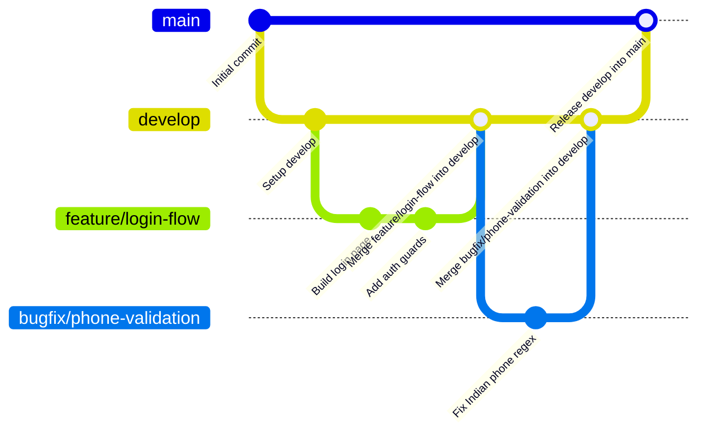

# AI Agents & Developer Workflow Guide

This document establishes the mandatory development workflows, branching strategies, and operational policies for all AI agents and human contributors working on this CRM codebase.

---

## 1. Git Branching Strategy & Nomenclature

We strictly follow a structured GitFlow-based branching strategy:

| Branch Type | Naming Convention | Base / Branched From | Merge Target | Purpose |
| :--- | :--- | :--- | :--- | :--- |
| **Main** | `main` | Repository Initial | *None (Protected)* | Production-ready stable release code. |
| **Develop** | `develop` | `main` | `main` | Primary active development and integration branch. |
| **Feature** | `feature/<feature-name>` | `develop` *(or `main` in special cases)* | **`develop` ONLY** | New features, enhancements, or UI additions. |
| **Bugfix** | `bugfix/<bug-name>` | `develop` or feature branch | **`develop` ONLY** | Bug fixes found in `develop` or ongoing feature branches. |
| **Hotfix** | `hotfix/<fix-name>` | `main` | `develop` | Critical emergency fixes for issues discovered in `main`. |

---

## 2. Cardinal Rules (Non-Negotiable)

1. **NEVER CODE DIRECTLY ON `main`:**
   - Direct commits to `main` are strictly forbidden.
   - All work happens in dedicated `feature/` or `bugfix/` branches, or through `develop`.

2. **NEVER MERGE FEATURE OR BUGFIX BRANCHES DIRECTLY INTO `main`:**
   - `feature/*` and `bugfix/*` branches must **only** be merged into `develop`.

3. **ONLY `develop` MERGES INTO `main`:**
   - `main` only receives merges from `develop` when a version or milestone is fully verified, tested, and ready for production.

4. **HOTFIX PROTOCOL:**
   - Bugs discovered in `main` are branched as `hotfix/<fix-name>`.
   - Once fixed and verified, they are merged into `develop`, and then `develop` merges into `main`.

5. **BRANCH NAMING CONVENTION:**
   - Features: `feature/lead-timeline-sync`, `feature/export-excel-custom-fields`, etc.
   - Bug fixes: `bugfix/fix-meta-webhook-timeout`, `bugfix/ist-date-offset-correction`, etc.
   - Hotfixes: `hotfix/auth-session-recovery-fix`, etc.
   - All lowercase, hyphen-separated.

---

## 3. Standard Git Workflow Lifecycle



### Step-by-Step Command Guide:

#### Starting a New Feature:
```bash
git checkout develop
git pull origin develop
git checkout -b feature/<feature-name>
```

#### Finishing a Feature:
```bash
git add .
git commit -m "feat: implement <feature-name>"
git checkout develop
git pull origin develop
git merge feature/<feature-name>
# Push develop
git push origin develop
```

#### Fixing a Bug found in Develop:
```bash
git checkout develop
git checkout -b bugfix/<bug-name>
# Implement fix
git commit -m "fix: resolve <bug-name>"
git checkout develop
git merge bugfix/<bug-name>
```

#### Hotfix for a Bug found in Main:
```bash
git checkout main
git checkout -b hotfix/<fix-name>
# Implement critical fix
git commit -m "hotfix: resolve <fix-name>"
git checkout develop
git merge hotfix/<fix-name>
git checkout main
git merge develop
```

---

## 4. Requirements & Documentation Alignment
- Any new requirement requested by the user must be logged into [A_Requirements/PROJECT_REQUIREMENTS.md](file:///Users/surojuhomsaisantosh/Documents/PROJECTS/UNIVERSAL%20CRM%20/A_Requirements/PROJECT_REQUIREMENTS.md).
- Any database schema changes must be documented and updated in [A_Requirements/supabase_schema.sql](file:///Users/surojuhomsaisantosh/Documents/PROJECTS/UNIVERSAL%20CRM%20/A_Requirements/supabase_schema.sql).
- **Daily Change Log Policy:** Maintain exactly **one markdown file per day** named `YYYY-MM-DD.md` in the `A_Changelog/` folder (which is git-ignored). Each day's file records multiple chronological entries in plain English with timestamps.

---

## 5. Mobile-First & Responsiveness Mandate (Non-Negotiable)

**Every single feature, screen, component, modal, table, and KPI metric developed in this CRM must be mobile-optimized.**

### Core Requirements:
1. **Target Viewport Support:**
   - Every layout must work flawlessly from **360px** (small mobile) up to 4K ultra-wide screens.
   - Absolutely zero horizontal page scrolling (`overflow-x: hidden` safety, no rigid fixed widths exceeding viewport).

2. **Touch-Friendly Ergonomics:**
   - Primary interactive elements (buttons, inputs, dropdowns, pagination buttons, links) must meet a minimum **40px–44px** touch target size.
   - Clickable cards must have clean hover, focus, and active tap states with appropriate margins.

3. **Responsive Grid & Spacing:**
   - Multi-column grids must gracefully scale down: e.g. `grid-cols-2 sm:grid-cols-2 md:grid-cols-3 lg:grid-cols-4` with compact spacing on mobile (`gap-2.5 sm:gap-3 md:gap-4`).
   - Cards in 2-column mobile layouts must use compact padding (`p-3 sm:p-4 md:p-5`) and automatic text truncation (`truncate`, `line-clamp-1`) to avoid overflowing on narrow screens (360px–390px).

4. **Data Presentation (Tables vs Cards):**
   - Complex data tables must provide a dedicated, touch-optimized mobile card/list view (or smooth horizontal scroll with sticky keys).
   - Leads, projects, activities, and metrics must be legible without pinch-to-zoom.

5. **Modals & Drawers:**
   - Modals on mobile must adapt to responsive bottom-sheets or full-width scrollable overlays with clear, accessible close buttons (`X`) and backdrop scroll-locking.

## 6. Database & Platform Access (Authorized by the user)

AI agents working on this codebase **have direct access** to the project's Supabase Postgres database and the Vercel CLI, and are **authorized to perform CRUD operations and apply schema migrations**.

### How to connect
- Connection string: `POSTGRES_URL` in `Website_CRM/.env.local` (never print, log, or commit its value).
- Use the `pg` package already in dependencies, e.g. `node -e` with `new Client({ connectionString, ssl: { rejectUnauthorized: false } })`.
- Vercel: the CLI is logged in. Use `vercel env ls --project crm` (read-only) for environment checks.

### Rules
1. **Migrations: ONE SQL file only.** `A_Requirements/supabase_schema.sql` is the single source of truth for the database. Never create other `.sql` files (`*.sql` is gitignored in this repo). For every DB change, add an idempotent section (IF NOT EXISTS / OR REPLACE / DROP … IF EXISTS) to that file **above** the RLS lockdown section, which must stay last. Then apply it inside a transaction (`BEGIN … COMMIT`). A fresh client DB is set up by running the whole file once.
2. **Additive changes are pre-approved:** `CREATE TABLE`, `ADD COLUMN`, indexes, seed rows, and storage buckets.
3. **Destructive changes need explicit user confirmation first:** `DROP`, `TRUNCATE`, `DELETE` without a narrow `WHERE`, column type changes, and bulk updates of existing rows.
4. **RLS:** New tables must `ENABLE ROW LEVEL SECURITY`. Server-only tables get no policies, and are accessed via the service role behind `checkActionAccess()`.
5. **No deployment:** DB access does not imply deploy rights. Never deploy or `git push` until the user explicitly says so (see Cardinal Rules).

---

<!-- BEGIN:nextjs-agent-rules -->

## This is NOT the Next.js you know

This version has breaking changes — APIs, conventions, and file structure may all differ from your training data. Read the relevant guide in `node_modules/next/dist/docs/` (resolved from this file's directory; in monorepos the `next` package may not be visible from the repo root) before writing any code. Heed deprecation notices.

This block is written and re-added by `next dev` — verify at `node_modules/next/dist/server/lib/generate-agent-files.js`. Removing it from a diff only re-creates the uncommitted change; committing it with your work keeps the tree clean.

<!-- END:nextjs-agent-rules -->
